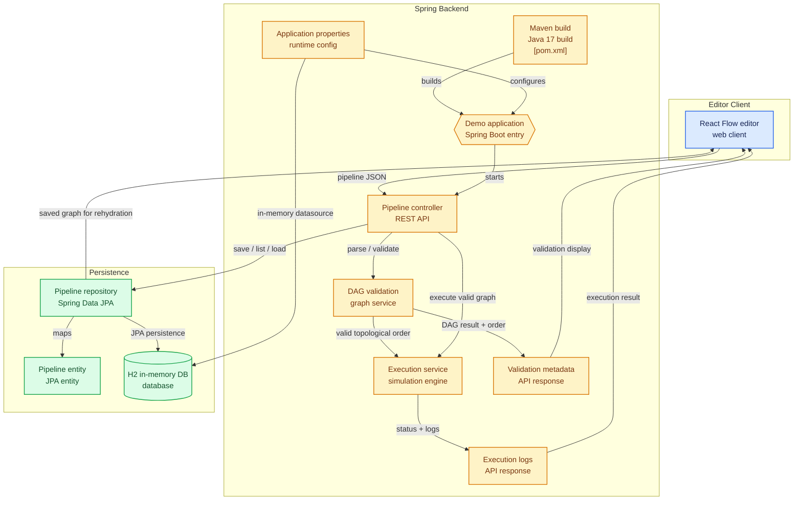

# PipeCanvas

## Overview
PipeCanvas is a full-stack workflow studio that lets users build, save, load, validate, and execute directed pipelines using a drag-and-drop node editor.
Its responsive landing page introduces the product and links directly to the React Flow canvas. The Spring Boot backend provides DAG validation, pipeline persistence with an H2 in-memory database, and a simulated execution engine.

## Architecture Diagram


## What’s Included
- Drag-and-drop pipeline building interface
- Responsive PieCanvas landing page with direct access to the editor
- Save/load pipeline persistence with Spring Data JPA + H2
- Backend DAG validation and topological execution order
- Pipeline execution engine that simulates text and LLM node behavior
- Toolbar actions for Save, Load, and Execute
- Frontend tests for toolbar rendering
- Backend integration test for `/pipelines/execute`

## Architecture
### Frontend
- React 18 + React Flow
- Zustand for state management
- Custom node components: Input, Output, Text, LLM, Timer, Condition, API, Database, Webhook
- Toolbar with buttons for saving, loading, and executing pipelines

### Backend
- Spring Boot 3.2.4
- Java 17
- Spring Data JPA + H2 database
- REST endpoints for pipeline parsing, saving, loading, and executing
- Execution engine walks nodes in topological order and generates a step-by-step log

## Supported Node Types
- `customInput` — Input data source
- `customOutput` — Output sink
- `text` — Static / dynamic text processing
- `llm` — Simulated OpenAI-style response node
- `timer` — Delay / scheduled trigger
- `condition` — Branching / decision node
- `api` — External API request stub
- `database` — Database action stub
- `webhook` — Webhook trigger stub

## API Endpoints
### `POST /pipelines/parse`
Validates the pipeline JSON and returns DAG metadata.
- Request form data: `pipeline=<json>`
- Response includes:
  - `is_dag`
  - `execution_order`
  - `num_nodes`
  - `num_edges`

### `POST /pipelines/save`
Saves a pipeline to the H2 database.
- Request form data: `pipeline=<json>`
- Response includes saved `id`

### `GET /pipelines`
Returns all saved pipelines from the database.

### `GET /pipelines/{id}`
Loads a saved pipeline by ID.
- Response includes `nodes` and `edges`

### `POST /pipelines/execute`
Validates and executes a pipeline.
- Request form data: `pipeline=<json>`
- Response includes `status` and `logs`

### Authentication
- `POST /auth/register` — accepts JSON `{ "name": "...", "email": "...", "password": "..." }`; name is required and passwords must be at least 8 characters. Creates an account and starts a session.
- `POST /auth/login` — accepts the same JSON credentials and starts a session for an existing account.
- `GET /auth/me` — returns the account for the current session.

Passwords are stored as PBKDF2 hashes. The browser session uses a credentialed cookie; the API currently allows the frontend origin `http://localhost:3000`.

## Running the Project
### Frontend
```bash
cd Frontend
npm install
npm start
```
Open `http://localhost:3000` in your browser.

### Backend
```bash
cd Backend-Java
.\mvnw.cmd spring-boot:run
```
The server listens on `http://localhost:8080`.

## Testing
### Backend
Run the Spring Boot tests:
```bash
cd Backend-Java
.\mvnw.cmd test
```
A dedicated integration test covers `/pipelines/execute`.

### Frontend
Run the React test suite:
```bash
cd Frontend
npm test -- --watchAll=false
```
A toolbar rendering test verifies Save / Load / Execute button presence.

## Notes
- The backend uses an H2 in-memory database by default, which resets when the server stops.
- The current load action fetches pipeline ID `1` for demo purposes. This can be extended to support an ID selector or pipeline list.
- The execution engine currently simulates runtime behavior rather than connecting to an actual external LLM or API.
